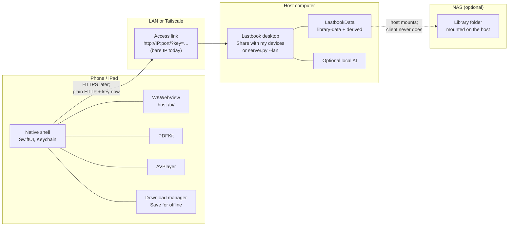

# Architecture

Lastbook Remote is a thin client. The host computer runs Lastbook and holds the library (on its disk, or on a NAS it has mounted). The iPhone or iPad talks only to that host, over the local network or a private VPN such as Tailscale.

## Native shell

A SwiftUI app wraps a small set of native surfaces around the host's existing UI:

- **Connection and library switcher.** Paste or scan the access link, or enter IP and port. Store the key in the Keychain. Show connection status and a way to reconnect when the host sleeps or the network changes.
- **WKWebView** of the host's `/ui/` (the Lastbook `web/` app). This is the fastest path to parity for browse, search, guides, maps, and Chat. The web view loads the access link; Lastbook sets the `sg_key` cookie and redirects (302) to a clean URL, and the cookie stays in the web view's store. Native requests do not use the cookie: they send `X-Lastbook-Key` on every request, and video URLs carry `?key=` (AVPlayer and AirPlay can't add headers).
- **PDFKit** for documents, and **AVPlayer** for video, when they beat the web view (Range seeking, Picture in Picture, AirPlay). The download manager uses the same URLs, with Range, so a save can resume.
- **Downloaded.** Items the person saved on this device (documents, videos, web pages, later encyclopedia articles and whole collections) are files in the app sandbox, excluded from iCloud backup and not synced to other devices, listed in a native screen with their sizes and free space, and opened with PDFKit, AVPlayer or a web view with no network. Caches (thumbnails, HTTP, recent pages) are separate, capped, and clearable.

There is no local Lastbook engine, no content pack installer, and no on-device AI model.

## Host and network

The host is a Mac, Windows, or Linux computer running Lastbook. Sharing is off unless the person turns on **Share this library with my devices** ([Lastbook PR #343](https://github.com/Immortal-Protocols/lastbook/pull/343)) or starts `python3 server.py --lan`. The server listens on `0.0.0.0`, ports 8890–8899 in the desktop app (8890 for the command-line server), as its own listener (`SHARE_SERVER`), separate from the loopback local reader. Access needs the key from `derived/lan-key` in the library data folder, sent as `?key=`, `X-Lastbook-Key`, `Authorization: Bearer`, or the `sg_key` cookie. The key survives Stop and Start; deleting that file while sharing is stopped makes a new one. Sharing left on starts again when Lastbook reopens.

Remote callers are read-only: they cannot run setup, check for updates, or change notes. They can read the library. Chat with the host's local AI works only if the host also turns on "Include Chat with this computer's local AI" (off by default); the client checks `/api/assistant/status` (`"shared": false` when it is off) and hides Chat otherwise.

The server is plain HTTP today and is not meant to be opened to the public internet. Away from home, the person puts both devices on a VPN such as Tailscale and connects to the **host's VPN IP**. Named addresses, including MagicDNS, are refused until Lastbook changes `host_ok()`.

If the library lives on a NAS, only the host mounts it. The phone never speaks SMB in the first version.

## Later, without redesign

When Lastbook adds them, the same shell can use Bonjour (`_lastbook._tcp`) to find a host, pairing tokens instead of only a shared URL key, a QR code on the share page, and TLS with a pinned certificate fingerprint. The access-link path should keep working for `server.py --lan` and for Safari.
